<h1 align="center">openVaim</h1>

<p align="center">
  Aim training on real VALORANT maps.<br>
  Pre-aim the routes you actually play, build your own drills and share them.
</p>

<p align="center">
  <a href="https://github.com/unkwsr/open-aim/releases/latest/download/openVaim-Setup.exe"><b>Download for Windows</b></a>
  &nbsp;·&nbsp;
  <a href="#build-your-own-drills">Make a drill</a>
  &nbsp;·&nbsp;
  <a href="CHANGELOG.md">What's new in 1.4.0</a>
  &nbsp;·&nbsp;
  <a href="#run-it-from-source">Run from source</a>
</p>

<p align="center">
  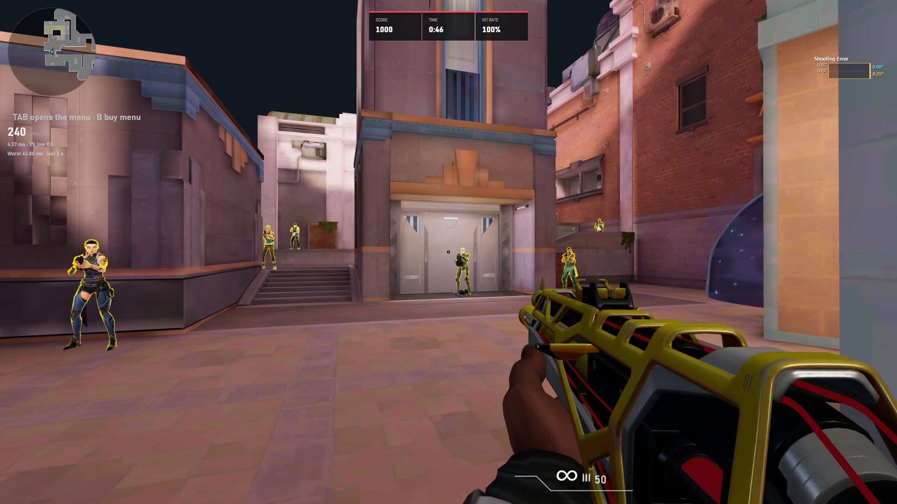
</p>

<br>

## Train where you play

Walk real routes and clear the angles you'd check in a match. There are 104 drills on
11 maps: Abyss, Ascent, Bind, Corrode, Haven, Icebox, Lotus, Pearl, Split, Summit and
Sunset, plus the training range. Bots peek, flash, trade and shoot back.

**New in 1.4.0:** Pearl and Icebox, every map rebuilt, and 35 new drills where bots
spawn in different spots each round.

- **Pre-aim:** walk a route and clear every common angle before anyone shows up.
- **Retakes and site holds:** hold a site while bots push in, or take it back.
- **Anti-flash:** they flash, then swing. Turn away in time, then take the duel.
- **Fundamentals:** grid shooting, multi-target drills and tracking in the Target Workshop.

Pick the enemy rank on any drill, from **Iron to Radiant**. Each rank keeps its own
records, and at higher ranks dying ends the round.

<br>

## Build your own drills

Pick a real map or build an arena from scratch in the **Creator**. Place bots, shape their
routes, add cover and press play. Switch between 2D, clean 3D and the **Detailed** view
of the actual game map, where you can put bots on boxes, crates and walls right where you
click.

<p align="center">
  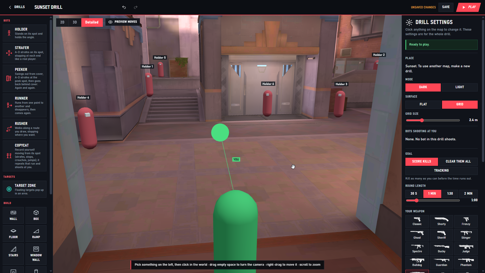
</p>

<table>
  <tr>
    <td width="50%">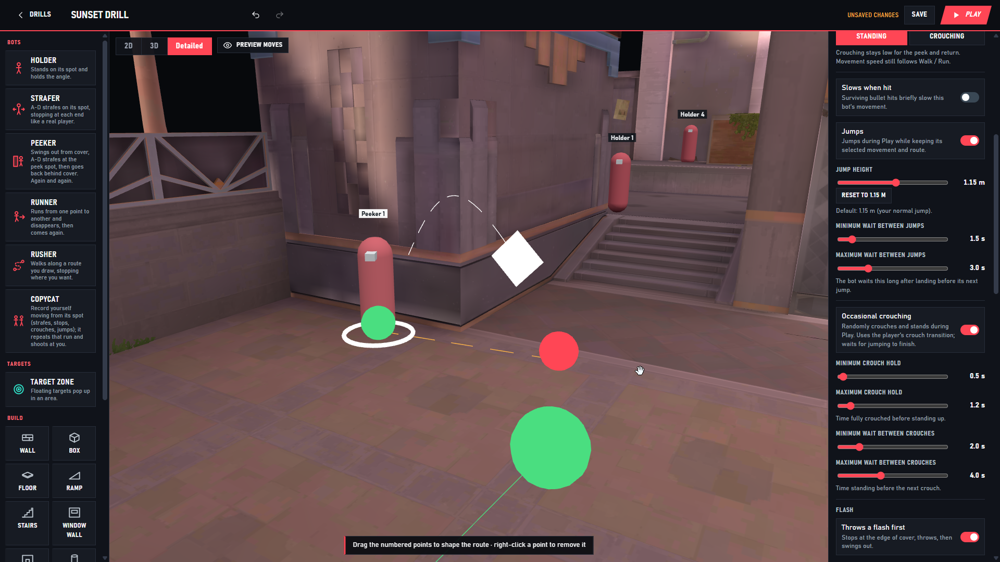</td>
    <td width="50%">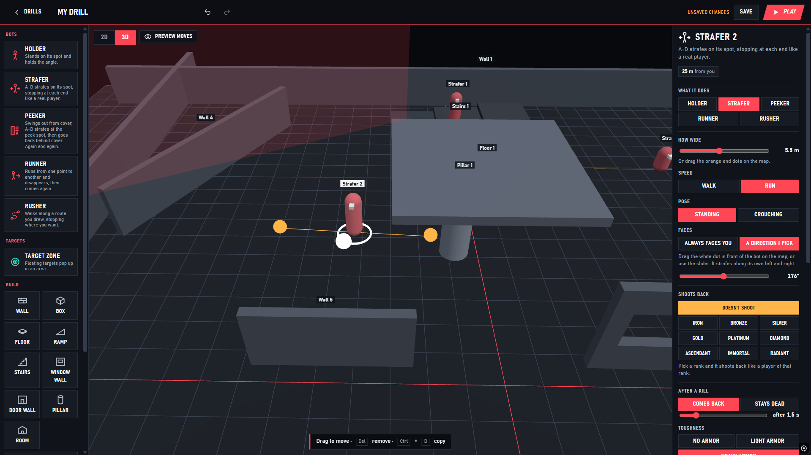</td>
  </tr>
  <tr>
    <td>Tune jumps, crouching, hit slowdown and flashes.</td>
    <td>Build your own spot with walls, boxes, stairs, ramps and window walls.</td>
  </tr>
</table>

Use holders, strafers, peekers, runners and rushers. Make bots show up when you cross a
line or when you kill another bot, give them random zones and spots so rounds don't
repeat, and save bots to a library to reuse them. Drills can run up to 30 minutes.

### Record yourself. Train against your run.

**Copycat bots** repeat your recorded movement: strafes, stops, crouches and jumps.
They can fire at the moments you fired or shoot as soon as they see you. Save recordings
to your **Runs library** for other drills.

<p align="center">
  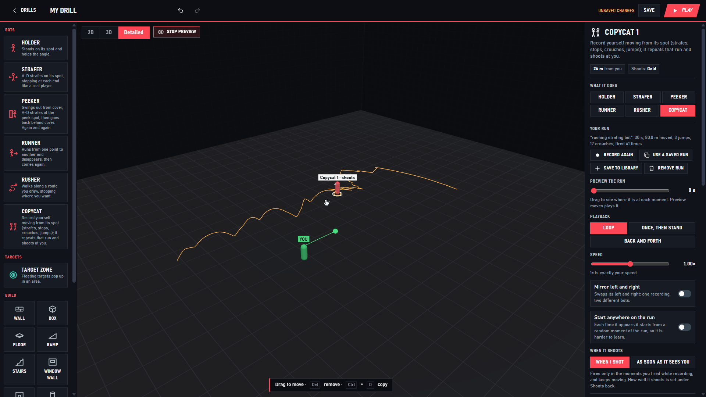
</p>

<br>

## Community Workshop

Publish your drills straight from the Creator and play everyone else's. Sign in with
Discord to publish, like drills and post scores. Every drill has a short share code and
its own leaderboard, and uploads are checked by a moderator before they go public.

<br>

## Agents, skins and sights

Press **N** in a round to play **Jett**, **Neon** or **Chamber**. Jett has her dash,
Updraft and Blade Storm; Chamber has Headhunter and Tour de Force on top of your gun.

<table>
  <tr>
    <td width="50%">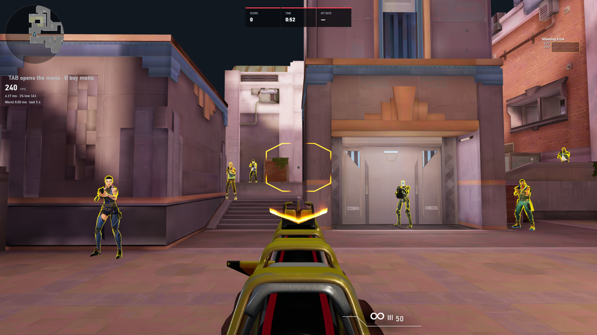</td>
    <td width="50%">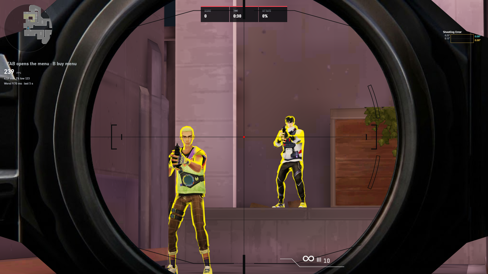</td>
  </tr>
  <tr>
    <td>Animated aiming on rifles, SMGs and heavy weapons.</td>
    <td>Sniper scopes for the Marshal, Outlaw and Operator.</td>
  </tr>
</table>

Pick skins in the **Collection** tab: Champions, Kuronami, Primordium, RGX and Gaia
Vandals, Recon, Helix and BlastX Phantoms, Arcane and Singularity Sheriffs, and a dozen
melee skins with their own inspect animations. Skins bring their own firing sounds and
kill effects, and every other gun gets a kill sound and banner too.

<table>
  <tr>
    <td width="33%">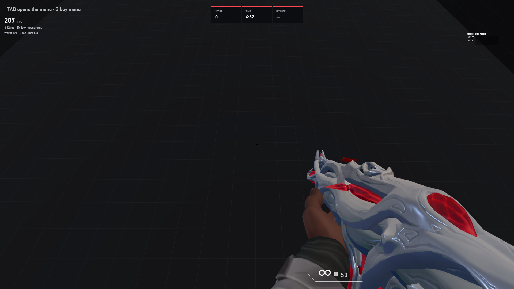</td>
    <td width="33%">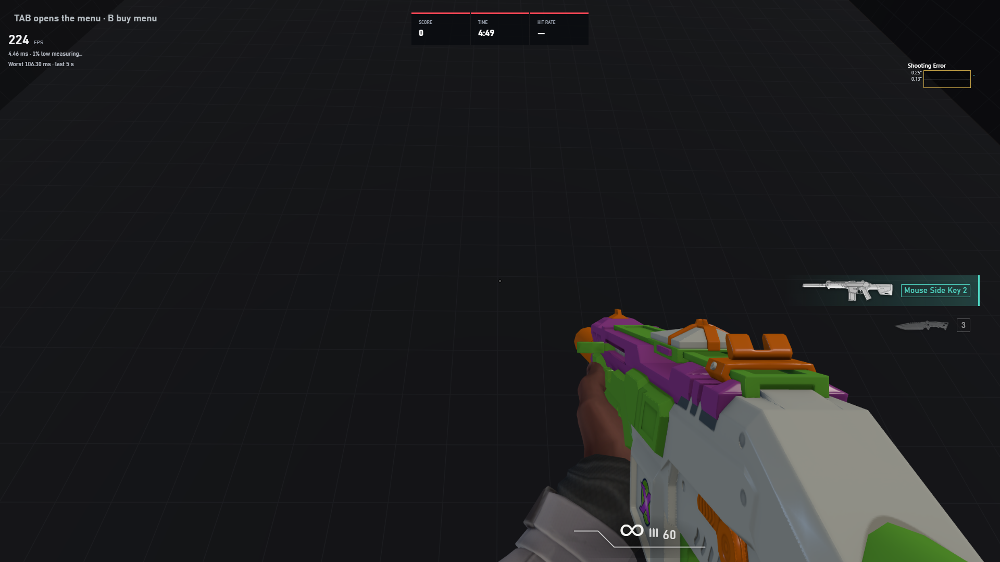</td>
    <td width="33%">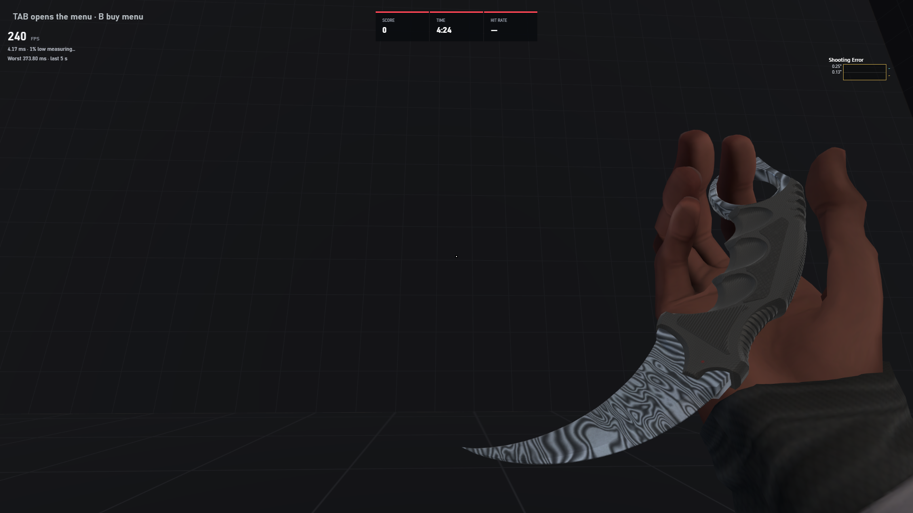</td>
  </tr>
  <tr>
    <td>Gaia White Vandal</td>
    <td>BlastX Phantom</td>
    <td>Damascus Steel Karambit</td>
  </tr>
</table>

<br>

## Every shot counts

Track score, time and hit rate while you play. The **shooting-error graph** shows a thin
bar per shot: yellow for spray error and blue for movement error. After a round you can
replay it on the map to see your route, the bots and every kill. Your training history
keeps every run.

<br>

## Smooth

The game runs on its own thread, separate from the menus, so frames stay steady. Turn on
**Smooth aim** in Settings > Video for even smoother turning, and **Map culling** if your
PC is on the slower side.

<br>

## Set it up like your game

**Import your VALORANT settings**, including sensitivity, ADS and scope multipliers,
crosshair and keybinds, with a preview, backup and Undo. Or use Sens tools to bring your
sensitivity over from another game.

Adjust resolution, stretched 4:3, render scale, viewmodel, weapon hand, flashes and
enemy outlines. Crosshair changes apply immediately in a drill.

<p align="center">
  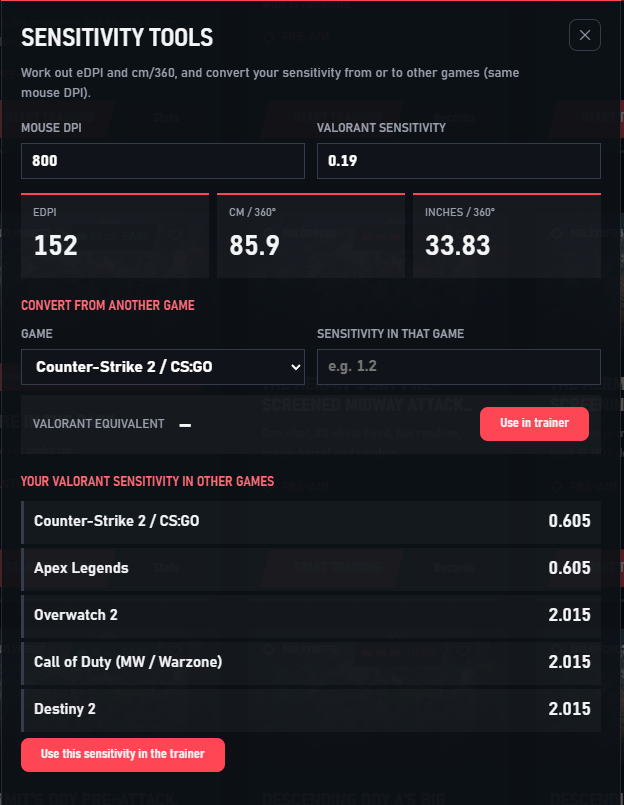
</p>
<p align="center">
  <sub>Bring your sensitivity over from CS2, Apex, Overwatch 2, Call of Duty or Destiny 2.</sub>
</p>

- **Your frame rate.** Match display, Unlimited or a custom 30–1000 FPS cap, with an FPS counter.
- **Fullscreen.** Starts fullscreen; F11 switches to a window and remembers your choice.
- **Your data stays on your PC** in `%APPDATA%\AimTrainer`. Training works offline; only the Workshop needs internet.
- **Backed up.** A backup is made at every start, and you can export to a folder whenever you like.

<br>

## Get it

1. Download and run **[openVaim-Setup.exe](https://github.com/unkwsr/open-aim/releases/latest/download/openVaim-Setup.exe)** and pick where to install it.
2. Import your VALORANT settings, or enter your sensitivity through **Sens tools**.
3. Pick a drill, make your own in the Creator, or grab one from the Workshop.

Requires Windows 10 or 11, any GPU with WebGL 2.
The game runs a small local server on port 8000. If another program already uses that port,
start openVaim with `--port=8001` (or any port from 1024 to 65535), for example by adding it
to the end of the shortcut's **Target**. You can also set the `AIM_PORT` environment variable.
Settings and training history are saved per port, so use the same port every time.
The lobby's **Updates** button shows what's new when a release is available.
Your settings and training data are kept when you update, including from AimTrainer 1.3.0.

Read the full [1.4.0 changelog](CHANGELOG.md) for everything that's new.

<br>

## Run it from source

You need [Node.js](https://nodejs.org) 20+ and the game files in `base/` and `app/site/`
(see [docs/game-files.md](docs/game-files.md)).

```bash
git clone https://github.com/unkwsr/open-aim.git
cd open-aim/app
npm install
npm start
```

`npm run build` makes the installer. How it's put together: [docs/architecture.md](docs/architecture.md).
Want to add a drill to the built-in list? See [docs/scenario-format.md](docs/scenario-format.md) and [CONTRIBUTING.md](CONTRIBUTING.md).

<br>

## Credits

Credit to the [ishoutu aim trainer](https://ishoutu.cn/aim) for the original idea and for the
map compression methods openVaim builds on.


<br>

---

<sub>
MIT licensed. Built with <a href="https://www.electronjs.org">Electron</a> and <a href="https://threejs.org">three.js</a>.
A personal project for testing, not affiliated with or endorsed by Riot Games.
VALORANT and its maps belong to Riot Games.
</sub>
