<h1 align="center">open-aim</h1>

<p align="center">
  Offline aim training on real VALORANT maps.<br>
  Pre-aim the routes you actually play, then build your own drills.
</p>

<p align="center">
  <a href="https://github.com/unkwsr/open-aim/releases/latest/download/AimTrainer-Setup.exe"><b>Download for Windows</b></a>
  &nbsp;·&nbsp;
  <a href="#build-your-own-drills">Make a drill</a>
  &nbsp;·&nbsp;
  <a href="CHANGELOG.md">What's new in 1.3.0</a>
  &nbsp;·&nbsp;
  <a href="#run-it-from-source">Run from source</a>
</p>

<p align="center">
  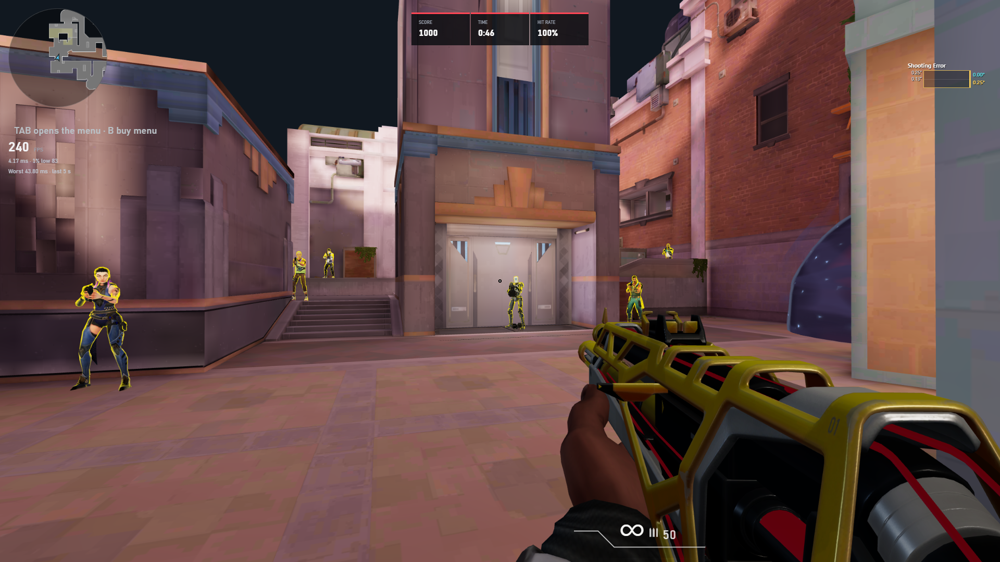
</p>

<br>

## Train where you play

Walk real routes and clear the angles you'd check in a match. Train on Ascent, Split,
Haven, Lotus, Bind, Corrode, Abyss, Summit and now **Sunset**, or work on your fundamentals
in the training range. Bots peek, flash and shoot back.

**New in 1.3.0:** six Sunset pre-aim drills across A Short, A Tube and B Main.
Choose **Easy** to learn the angles or **Hard** to face bots that shoot back.

- **Pre-aim:** walk a route and clear every common angle before anyone shows up.
- **Angle holding:** hold one spot while bots wide-swing and jiggle-peek.
- **Anti-flash:** they flash, then swing. Turn away in time, then take the duel.
- **Fundamentals:** micro-flicks, Drift-style clicking, strafers and tracking.

<br>

## Build your own drills

Pick a real map or build an arena from scratch in **Studio**. Place bots, shape their
routes, add cover and press play. Switch between 2D, clean 3D and the **Detailed** view
of the actual game map.

<p align="center">
  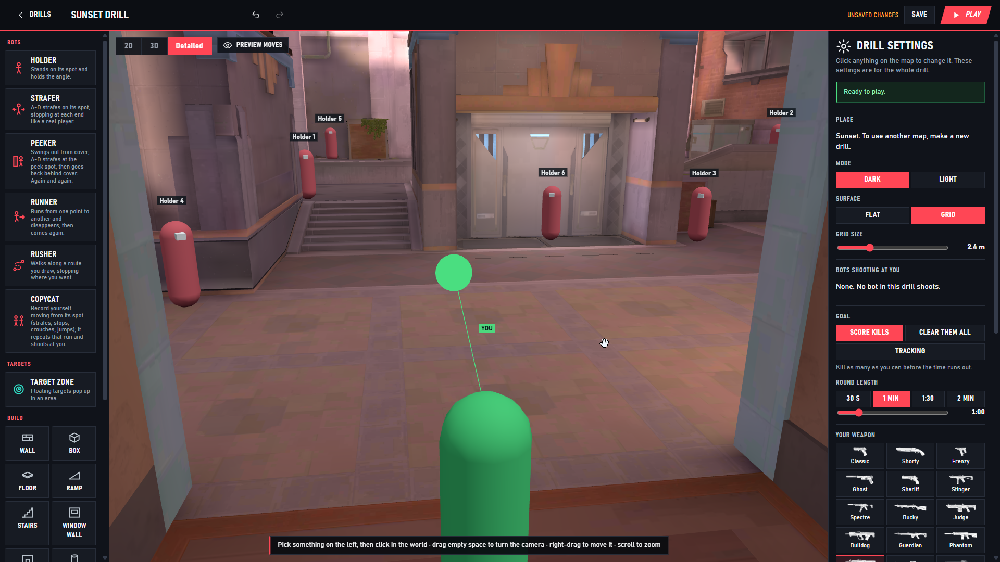
</p>

<table>
  <tr>
    <td width="50%">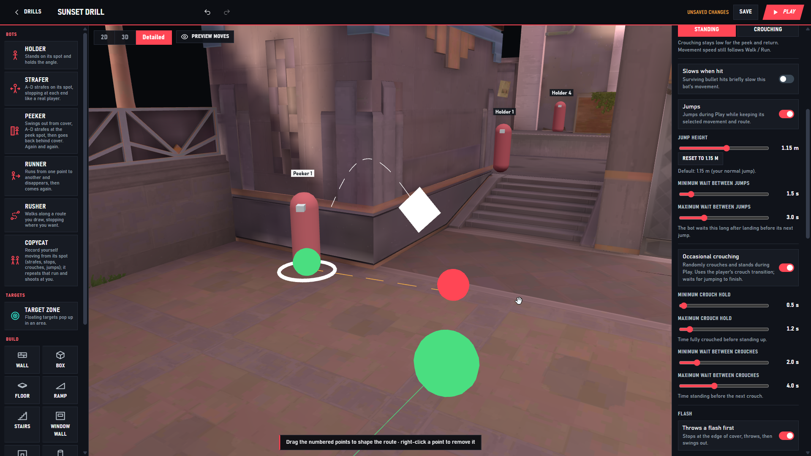</td>
    <td width="50%">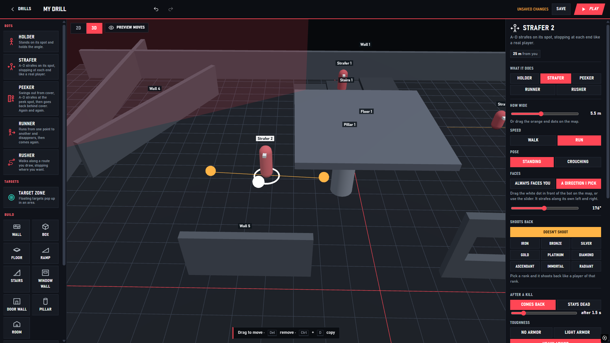</td>
  </tr>
  <tr>
    <td>Tune jumps, occasional crouching, hit slowdown and flashes.</td>
    <td>Build your own spot with walls, boxes, stairs, ramps and window walls.</td>
  </tr>
</table>

Use holders, strafers, peekers, runners and rushers, with shooting difficulty from
**Iron to Radiant**. Add unpredictable movement, jumps and occasional crouches to vary
the duel. Build arenas from **12 to 200 m**, with Dark or Light looks and Flat or Grid
surfaces. Move, resize and rotate cover with snapping, undo and redo.

### Record yourself. Train against your run.

**Copycat bots** repeat your recorded movement: strafes, stops, crouches and jumps.
They can fire at the moments you fired or shoot as soon as they see you. Preview the
route, adjust playback speed, mirror it, and save recordings to your **Runs library**
for other drills.

<p align="center">
  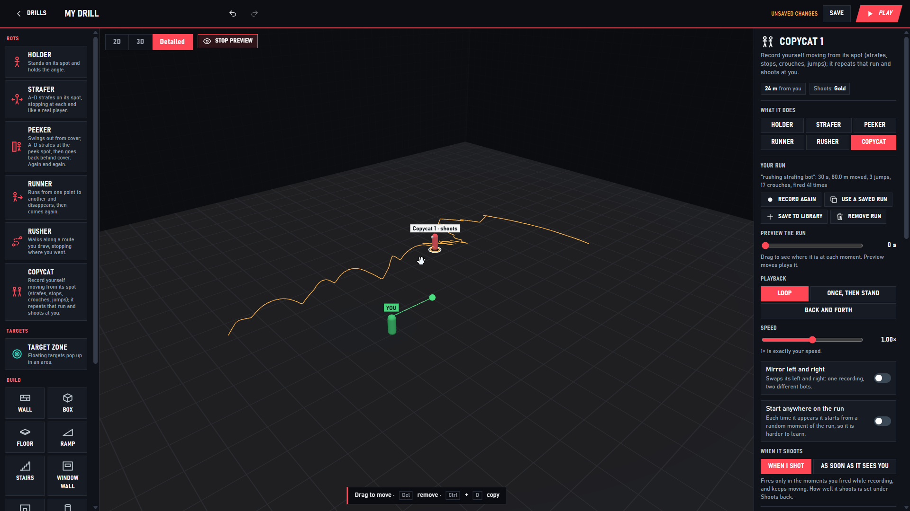
</p>

<br>

## New sights. More skins.

Rifles, SMGs and heavy weapons have new animated aiming visuals. The gun rises to
your eye and the sight moves with its sway and recoil. The Marshal, Outlaw and Operator
have sniper scopes with smoother opening animations. Aim speed, zoom, sensitivity,
spread and accuracy are unchanged.

<table>
  <tr>
    <td width="50%">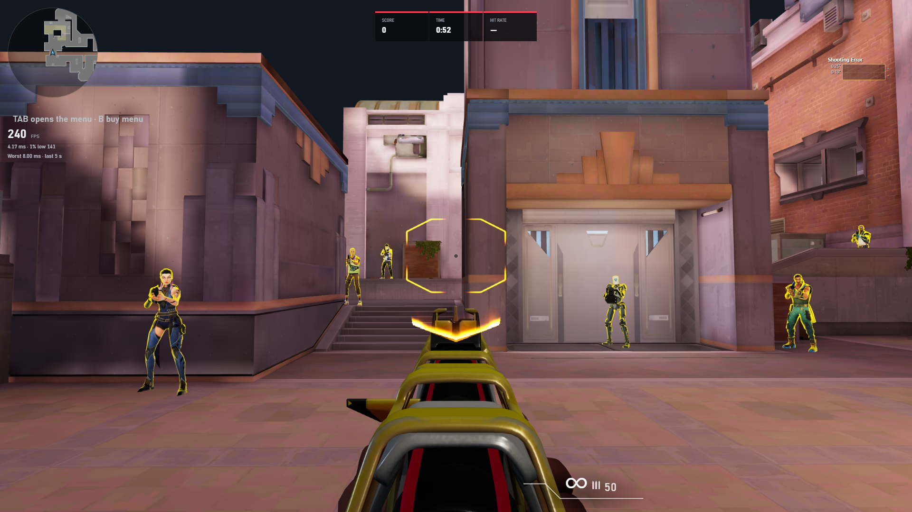</td>
    <td width="50%">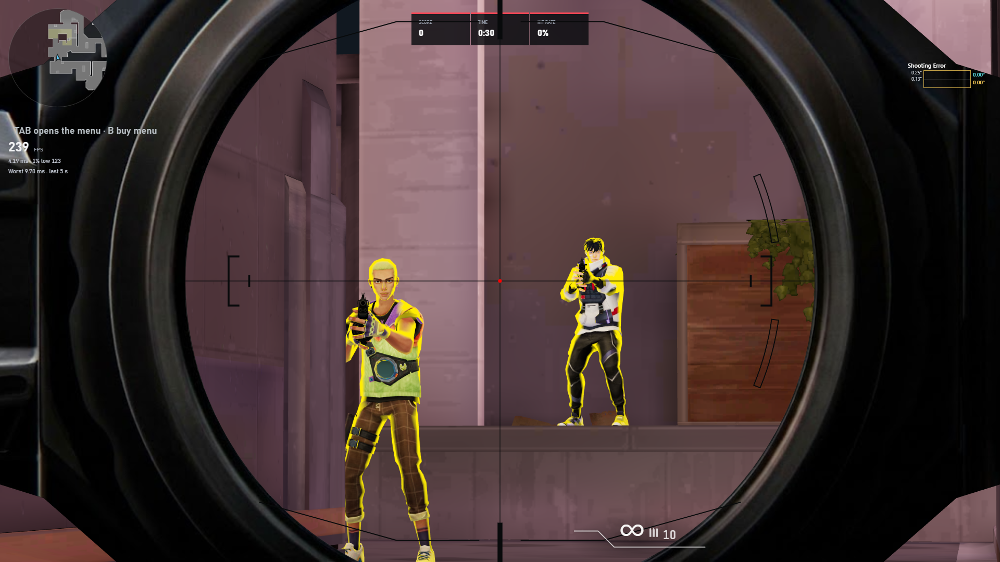</td>
  </tr>
  <tr>
    <td>New rifle ADS, with each skin keeping its own look.</td>
    <td>Sniper scopes for the Marshal, Outlaw and Operator.</td>
  </tr>
</table>

**15 new skins** include RGX and Gaia Vandals, BlastX Phantom, Prime Guardian,
Singularity Sheriff, Smite Ghost, Araxys and Rogue Operators, and six melee skins.
Several have their own firing sounds, kill sounds and effects. Melee skins have equip,
attack and **inspect (Y)** animations. Choose yours in **Settings**.

<table>
  <tr>
    <td width="33%">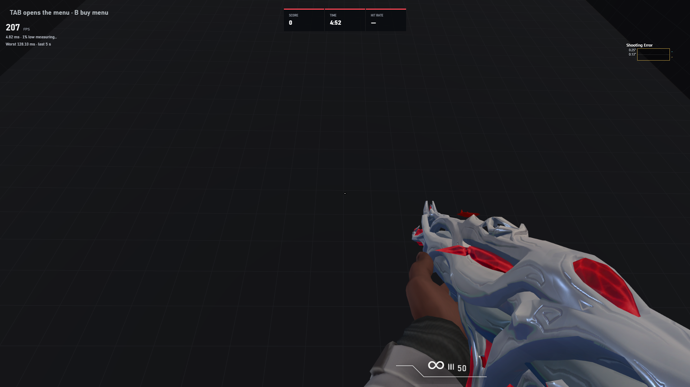</td>
    <td width="33%">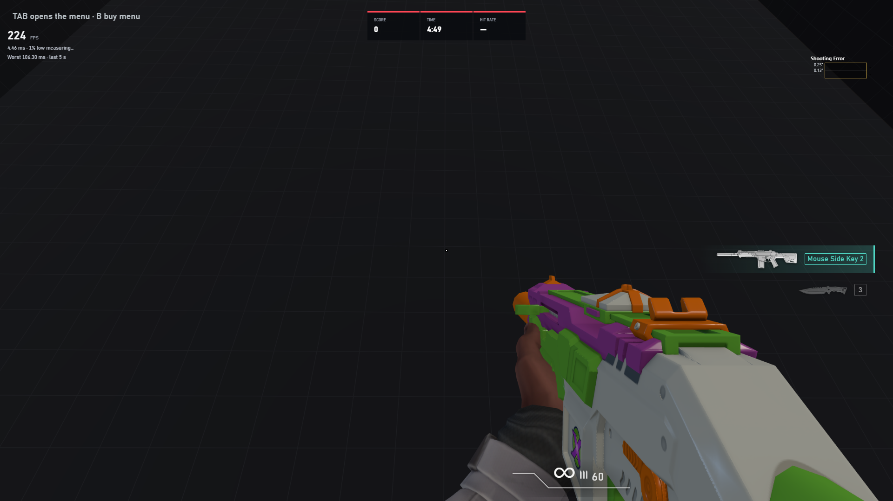</td>
    <td width="33%">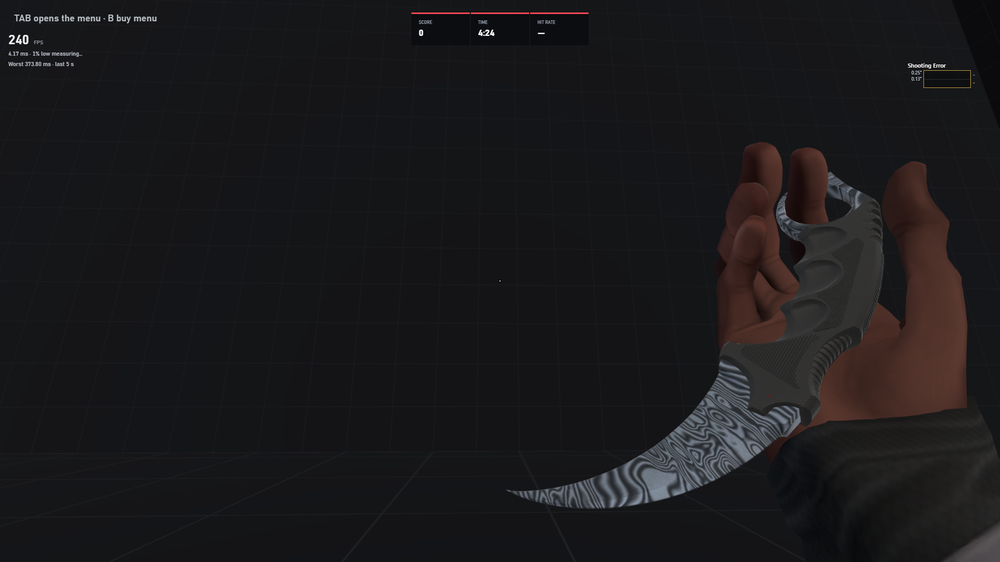</td>
  </tr>
  <tr>
    <td>Gaia White Vandal</td>
    <td>BlastX Phantom</td>
    <td>Damascus Steel Karambit</td>
  </tr>
</table>

<br>

## Every shot counts

Track score, time and hit rate while you play. The rebuilt **shooting-error graph**
shows a thin bar per shot: yellow for spray error and blue for movement error.
Your training history keeps every run.

New headshot effects, target-hit audio and optional **advanced bullet tracers** add
feedback to your shots. Weapons and skins are prepared before a drill starts to reduce
stutters when firing and switching guns.

<br>

## Set it up like your game

**Import your VALORANT settings**, including sensitivity, ADS and scope multipliers,
crosshair and keybinds, with a preview, backup and Undo. Or use Sens tools to bring your
sensitivity over from another game.

Adjust resolution, stretched 4:3, render scale, viewmodel, weapon hand, flashes and
enemy outlines. Crosshair changes apply immediately in a drill.

<p align="center">
  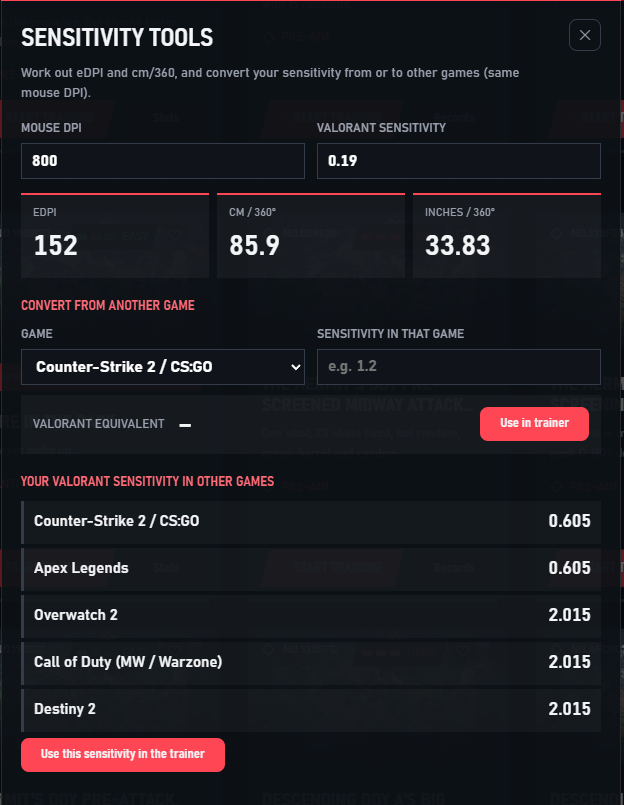
</p>
<p align="center">
  <sub>Bring your sensitivity over from CS2, Apex, Overwatch 2, Call of Duty or Destiny 2.</sub>
</p>

- **Your frame rate.** Unlimited, Match display or a custom 30–1000 FPS cap, with a live FPS meter and 1% lows.
- **Fullscreen.** Starts fullscreen; F11 switches to a window and remembers your choice.
- **Offline.** No account, no internet. Your data stays in `%APPDATA%\AimTrainer`.
- **Backed up.** A backup is made at every start, and you can export to a folder whenever you like.

<br>

## Get it

1. Download and run **[AimTrainer-Setup.exe](https://github.com/unkwsr/open-aim/releases/latest/download/AimTrainer-Setup.exe)**.
2. Import your VALORANT settings, or enter your sensitivity through **Sens tools**.
3. Pick a drill or make your own in Studio.

Requires Windows 10 or 11, any GPU with WebGL 2.
The lobby's **Updates** button shows what's new when a release is available.
Your settings and training data are kept when you update.

Read the full [1.3.0 changelog](CHANGELOG.md) for all additions and fixes.

<br>

## Run it from source

You need [Node.js](https://nodejs.org) 20+ and the game files in `site/`
(see [docs/game-files.md](docs/game-files.md)).

```bash
git clone https://github.com/unkwsr/open-aim.git
cd open-aim/app
npm install
npm start
```

`npm run build` makes the installer. How it's put together: [docs/architecture.md](docs/architecture.md).
Want to add a drill to the built-in list? See [docs/scenario-format.md](docs/scenario-format.md) and [CONTRIBUTING.md](CONTRIBUTING.md).

<br>

## Credits

The 3D maps come from the [ishoutu aim trainer](https://ishoutu.cn/aim). They are not my
work and are not covered by this project's MIT license.

<br>

---

<sub>
MIT licensed. Built with <a href="https://www.electronjs.org">Electron</a> and <a href="https://threejs.org">three.js</a>.
A personal project for testing, not affiliated with or endorsed by Riot Games.
VALORANT and its maps belong to Riot Games.
</sub>
