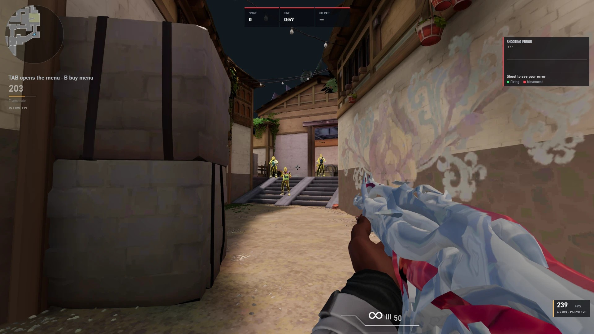
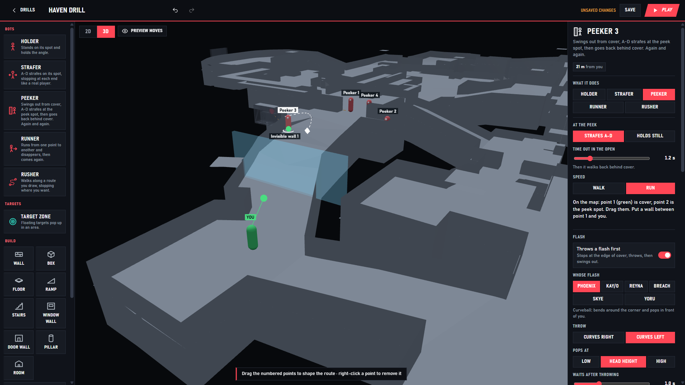
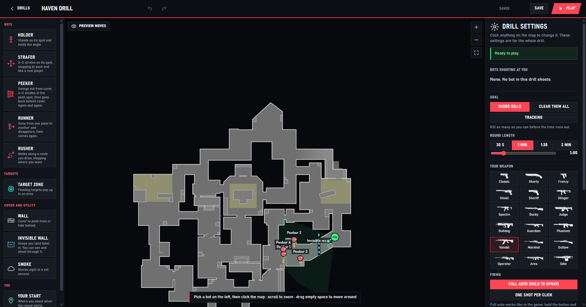
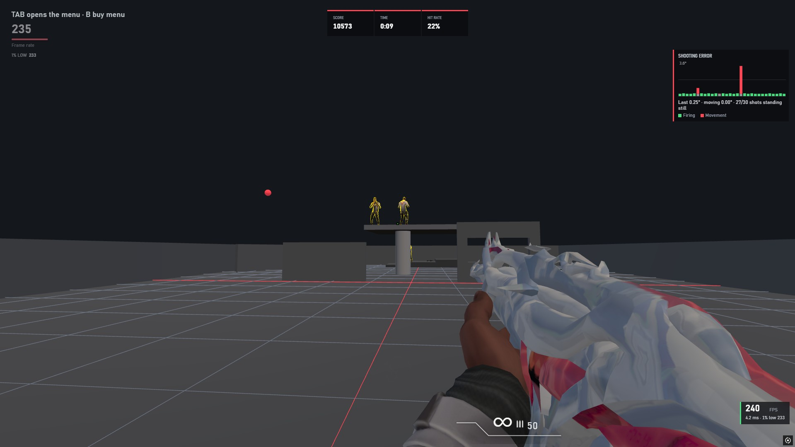
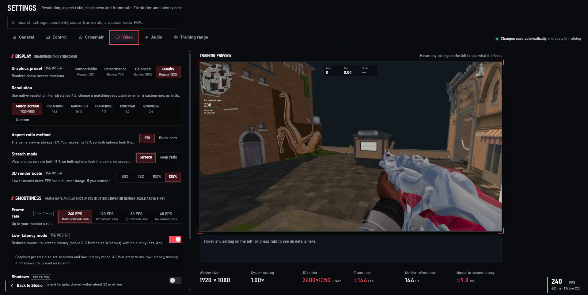
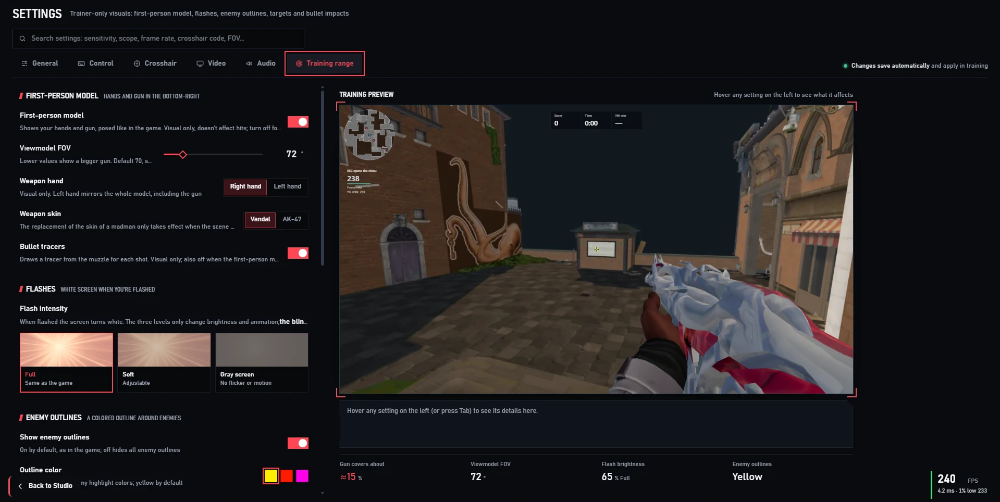

<h1 align="center">open-aim</h1>

<p align="center">
  Offline aim training on real VALORANT maps.<br>
  Pre-aim the routes you actually play, then build your own drills.
</p>

<p align="center">
  <a href="https://github.com/unkwsr/open-aim/releases/latest/download/AimTrainer-Setup.exe"><b>Download for Windows</b></a>
  &nbsp;·&nbsp;
  <a href="#build-your-own-drills">Make a drill</a>
  &nbsp;·&nbsp;
  <a href="#run-it-from-source">Run from source</a>
</p>

<p align="center">
  
</p>

<br>

## Train where you play

99 drills across Ascent, Split, Haven, Lotus, Bind, Corrode, Abyss, Summit and a training
range. Walk real routes and clear the angles you'd check in a match. Bots peek, flash and
shoot back.

- **Pre-aim:** walk a route and clear every common angle before anyone shows up.
- **Angle holding:** hold one spot while bots wide-swing and jiggle-peek.
- **Anti-flash:** they flash, then swing. Turn away in time, then take the duel.
- **Fundamentals:** micro-flicks, Drift-style clicking, strafers and tracking.

<br>

## Build your own drills

Open **Creator** in the top bar. Pick a map or an empty range, drop in bots, press play.

<p align="center">
  
</p>

<table>
  <tr>
    <td width="50%"></td>
    <td width="50%"></td>
  </tr>
  <tr>
    <td>Lay it out on the real map. Holders, strafers, peekers, runners and rushers, each one draggable.</td>
    <td>Or build your own spot: walls, boxes, stairs, ramps and window walls.</td>
  </tr>
</table>

Every bot can be tuned: how far it strafes, walk or run, crouch, which agent's flash it
throws, and which rank it shoots back like, from Iron to Radiant.

<br>

## Every shot counts

<p align="center">
  
</p>

Score, time and hit rate up top. On the right, a live shooting-error graph that shows
whether you missed because of your aim or because you were still moving. Your history
keeps every run.

<br>

## Set it up like your game

<table>
  <tr>
    <td width="50%"></td>
    <td width="50%"></td>
  </tr>
  <tr>
    <td>Resolution, stretched 4:3, render scale, frame rate and low-latency mode, with a live preview.</td>
    <td>Viewmodel FOV, weapon hand, flash brightness and enemy outline color.</td>
  </tr>
</table>

<p align="center">
  
</p>
<p align="center">
  <sub>Bring your sensitivity over from CS2, Apex, Overwatch 2, Call of Duty or Destiny 2.</sub>
</p>

- **Fast.** Runs at your monitor's refresh rate, with a live FPS meter and 1% lows.
- **Offline.** No account, no internet. Your data stays in `%APPDATA%\AimTrainer`.
- **Backed up.** A backup is made at every start, and you can export to a folder whenever you like.

<br>

## Get it

1. Download **[AimTrainer-Setup.exe](https://github.com/unkwsr/open-aim/releases/latest/download/AimTrainer-Setup.exe)**
   (or the [portable exe](https://github.com/unkwsr/open-aim/releases/latest/download/AimTrainer.exe)).
2. Open **Sens tools**, pick your game, enter your sens and DPI.
3. Press **Quick start**.

Windows 10 or 11, any GPU with WebGL 2. A 144 Hz monitor helps. `F11` toggles fullscreen, `Esc` pauses.

<br>

## Run it from source

You need [Node.js](https://nodejs.org) 20+ and the game files in `site/`
(see [docs/game-files.md](docs/game-files.md)).

```bash
git clone https://github.com/unkwsr/open-aim.git
cd open-aim/app
npm install
npm start
```

`npm run build` makes the installer. How it's put together: [docs/architecture.md](docs/architecture.md).
Want to add a drill to the built-in list? See [docs/scenario-format.md](docs/scenario-format.md) and [CONTRIBUTING.md](CONTRIBUTING.md).

<br>

---

<sub>
MIT licensed. Built with <a href="https://www.electronjs.org">Electron</a> and <a href="https://threejs.org">three.js</a>.
A personal project for testing, not affiliated with or endorsed by Riot Games.
VALORANT and its maps belong to Riot Games.
</sub>
